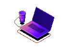

<picture>
  <source media="(prefers-color-scheme: dark)" srcset="assets/integratedai-banner-1200x300-dark.png">
  
</picture>

<h1 align="center">Jackson Chai</h1>

  PhD in Computer Science (Human-Computer Interaction) 
  Founder at IntegratedAI Pte. Ltd. 
  Space Technology • Artificial Intelligence • Human-Computer Interaction

 

## Focus

- Space technology: lunar terrain mapping, rover mission planning, and simulation.
- Artificial intelligence: AI-assisted navigation, route comparison, and planning.
- Human-computer interaction: tools for exploring 3D terrain and working with AI.

---

## Current Projects

At IntegratedAI, I am working on four projects for lunar exploration. Their repositories are not public yet as they are still work-in-progress.

- **Lunar Explorer**: AI-assisted lunar navigation to explore terrain, compare routes, and plan rover missions in 3D.
- **VR rover simulation**: An immersive environment for practising rover operations and exploring lunar terrain before a mission.
- **Lunar Base Builder**: A 3D planning tool for arranging equipment and infrastructure on lunar terrain.
- **Terrain Studio**: A tool for exploring Earth test sites and comparing their terrain with lunar reference areas in 3D.

---

## Public Repositories

### Space Technology

- [**space-tech-lab**](https://github.com/sg98ccy/space-tech-lab): Interactive 3D ion-thruster visualisation with a guided explanation of how it works.

### Agent Skills

Reusable skills for AI agents:

- [**clear-writing**](https://github.com/sg98ccy/clear-writing): Guidance for drafting, revising, and reviewing clear writing while preserving meaning and evidence.
- [**coding-practices**](https://github.com/sg98ccy/coding-practices): Guidance for implementation, refactoring, and code review, with clear responsibilities and data ownership.
- [**hci**](https://github.com/sg98ccy/hci): Source-backed human-computer interaction guidance for designing and reviewing interfaces, AI interactions, and usability studies.
- [**research-paper-writing**](https://github.com/sg98ccy/research-paper-writing): Guidance for writing research papers.

---

## Research Interests

- Space technology and lunar exploration.
- 3D terrain visualisation and simulation.
- Embodied AI and autonomous robotic systems.
- Rover navigation and mission planning.

---

   
  <i>See you around!</i>

  
    Last updated: 9 November 2026
  

